# Biomarker pipelines: RNA-seq FASTQ to biomarker result and report

**Research use only. Not a clinical or diagnostic device.**
Colon tissue, tumour vs normal, human paired-end bulk RNA-seq. One Nextflow workflow takes a folder of FASTQ files and a `metadata.csv` and gives gene counts, quality control, differential expression, pathways, biomarker candidates (or scores from the locked 9-gene model) and one report.

> This README describes the branch `feat/one-workflow` (not merged, not committed yet). Every number below was measured on the development pod (16 CPUs, 64 GB memory); items that were not tested are marked **NOT TESTED**.
>
> **Status of this version (2026-10-23):** scanner tests 30 of 30 (as of 2026-10-22), stub suite 91 cases (90 pass and 0 fail at the last full run, plus the byte-identity guard that now runs from a vendored fixture), service tests 25 of 25 plus 16 of 16 browser checks, strandedness and RNA-QC unit tests 14 of 14. A real 6-sample demo run (83 of 83 tasks) reproduced the earlier featureCounts counts byte for byte. The 19-sample real-data comparison and the 15-sample independent validation have **not** been run in this repository; treat the numbers in sections 8 and 10 as results of the earlier version.
>
> **Repository (2026-10-23):** public at `https://github.com/atharvashirke78/Biomarker` (MIT, see `LICENSE`), history starting at commit `a2c8890` (release candidate tag `v0.9.0-rc1`). Code, service and pipeline resolve their own location (`code_dir` from `nextflow/`, the service from its own folder); the tool environments and the reference are still read from the install folder `BIOMARKER_INSTALL_DIR` (default `/workspace/Biomarker_pipeline`). Job service hardened: Host and Origin checks, JSON-only writes, optional token, sandboxed reports.
>
> For the team that builds a user interface on top of this pipeline: read `docs/INTEGRATION_GUIDE.md` (input rules, command, outputs, status) and `service/README.md` (the thin job service).

**Contents:** 1 What is in this repository · 2 Quick start · 3 How the workflow runs · 4 Short architecture · 5 Quality control · 6 Modes and options · 7 What you get · 8 Example output · 9 Needs and run times · 10 Tests · 11 Known limits · 12 Repository map · 13 Extending the pipeline · 14 Reproducibility record · 15 FAQ · 16 Glossary · 17 Job service

## 1. What is in this repository

| Pipeline | What it does | Status |
|---|---|---|
| **Diagnostic, one workflow** (`nextflow/main.nf`, entry `RUN`) | FASTQ folder in, report out. Mode `discover` (find biomarkers) or `apply` (score with the locked model) | Built. Stub suite 90 of 91; regression on the 19 development samples passes; real runs on development samples only |
| **Locked diagnostic model** (`lock/diagnostic_v1/`) | 9 genes (8 up: KRT80, KRT23, GRIN2D, FUT1, ETV4, LARGE2, VSNL1, GTF2IRD1; 1 down: OSR1), cutoff 1.352325902, hash-checked, never changed by a run | Locked 2026-10-14 (tag `lock-diagnostic-v1`) |
| **Independent validation** (15 held-out samples) | Apply the locked model once, pre-registered pass rule | **Not run yet** |
| Older entries `-entry QUANT`, `ANALYSIS`, `DISCOVER` and launchers `scripts/rnaseq.sh`, `run_diagnostic.sh`, `run_validation.sh` | The steps of the workflow one at a time | Kept, behaviour unchanged |
| **Prognostic** (survival) | Design draft only: `docs/PREREG_prognostic_DRAFT.md`, not approved, nothing run | **Not built** |
| **Predictive** (treatment response) | Nothing | **Not built** (`config/questions.yaml` stops a run that asks for it) |

## 2. Quick start

```bash
# 1. one folder: paired FASTQ files + metadata.csv  (required: sample_id,group; optional: batch_or_study,patient_id)
# 2. one command (nextflow is not on the default PATH; use the full path or add it to PATH)
/workspace/Biomarker_pipeline/env/bin/nextflow run /workspace/Biomarker_pipeline_onewf/nextflow/main.nf \
    --input_dir /path/to/my_run  [--output_dir /path/to/results]  [--mode discover|apply]  [-resume]
```
Only `input_dir` (and optionally `output_dir`) change per run; both can also be set once in the USER SETTINGS block at the top of `nextflow/nextflow.config`. With no `output_dir` the results go to `<input_dir>/Result/`. An empty or wrong `input_dir` stops the run at the start; there is no default folder and no test data fallback. First-time guide: **`docs/RUN_IN_5_STEPS.md`**. All options: `docs/README_one_workflow.md`.

Try it on a small example (development samples, about 100 MB): `examples/make_example_input.sh --out my_example`, then run with `--input_dir my_example --mode apply --cohort development`.

### Inputs and outputs at a glance

| | What | Notes |
|---|---|---|
| **Input 1** | Paired-end FASTQ, one pair per sample: `<id>_R1/_R2`, `_R1_001/_R2_001`, `.R1/.R2` or `_1/_2`; `.fastq.gz` or `.fq.gz`; one naming style per folder | Human, bulk RNA-seq, GRCh38 / GENCODE v50. Several lanes per sample, single-end, uncompressed files and other species are not supported |
| **Input 2** | `metadata.csv`, one row per sample | Required: `sample_id`, `group` (normal / tumour and aliases). Optional: `batch_or_study`, `patient_id`. Values of `sample_id` and batch/study: letters, digits, `. _ -` only |
| **Options** | `--output_dir`, `--mode discover\|apply`, `--cohort development\|validation` (apply), `--stop_after quant\|analysis\|discover`, `-resume` | Thresholds are not options: they live in `conf/thresholds.config` |
| **Output (always)** | `00_input/` scan and QC exclusions, counts (`04_counts/`, `contract/`), sample QC table (PASS/WARN/FAIL with reason), cohort QC plots, MultiQC, `10_report/report/report.html` and `.md`, `run_info.json`, `params.json`, `tool_versions.tsv`, `10_report/manifest.json` (sha256 of inputs, configs, lock and outputs) | |
| **Output (discover)** | DESeq2 tables and volcano / MA / heatmap, ORA and GSEA tables and plots, `candidate_table.tsv` with the funnel and per-rule flags, LASSO panel (`model_genes.tsv`, `model_spec.txt`, cutoff) with development performance labelled optimistic | A small cohort gives "NO MODEL FITTED", not an error |
| **Output (apply)** | `09_locked_model/scores.tsv` (score and call per sample), `evaluation.tsv` when labels are complete | The locked 9-gene model is never refitted |
| **Via the job service** | The same files, plus a JSON summary (QC counts, funnel, model), the figure list and a live per-step and per-sample status | `service/README.md` |

## 3. How the workflow runs

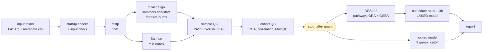
*Left to right: quantification and QC are shared. `discover` continues through the upper branch (DESeq2, pathways, candidate rules, LASSO), `apply` through the lower branch (locked model). `--stop_after quant` stops at the yellow gate so you can read the QC first; the same command with `-resume` continues.*

| Stage | Tool (version) | Key setting (`conf/thresholds.config`) | Output folder |
|---|---|---|---|
| Input and startup checks | `scripts/input_scan.py`, Groovy checks | sample IDs: letters, digits, `. _ -` only; at least 3 samples per group (provisional); with several batches every batch needs both groups | `00_input/` |
| Trimming | fastp 1.4.0 | quality 20, minimum length 36 | `01_fastp/` |
| Alignment | STAR 2.7.11b, samtools 1.24 | one STAR job at a time (about 29 GB) | `02_alignment/` |
| Counting | featureCounts 2.1.1 (MAPQ 10) and Salmon 1.10.3 + tximport | both routes are kept | `04_counts/`, `03_quant_salmon/`, `contract/` |
| QC | `sample_qc`, DESeq2 vst, MultiQC 1.35; strandedness cross-check (RSeQC 5.0.6 `infer_experiment.py` against the Salmon library type, flag only, `run_strand_check`); RNA-quality metrics (exonic/intronic share, duplication, TIN, 3'/5' coverage, rRNA and mitochondrial share) as cohort-relative flags, never gates (`run_rnaqc`) | see section 5 | `05_cohort_qc/` (incl. `strandedness_check.tsv`, `rna_qc_metrics.tsv`), `08_multiqc/` |
| Differential expression | DESeq2 1.50.2, apeglm | design `~ batch + group` (or `~ group`), adjusted p < 0.05, \|log2FC\| >= 1 | `06_dge/` |
| Pathways | clusterProfiler 4.18.4, fgsea 1.36.2 | GO BP, Hallmark; gene sets 10 to 500 genes | `07_pathway/` |
| Candidate rules and model | `candidate_rules.R`, glmnet 4.1.10 (LASSO); opt-in fully nested internal estimate with label-permutation null (`run_nested_validation`, rules 1-2 only, report-only, see `docs/NESTED_VALIDATION_DESIGN.md`) | leave-one-out robustness rule 3b, see section 6 | `09_discover/` |
| Locked scoring | `scripts/apply_locked_model.R` | no tuning, hash-checked lock files | `09_locked_model/` |
| Report | `scripts/make_report.py` | cohort-aware banner; stage list, methods and versions, limitations; shows `09_discover/04_validation/` only if that folder exists (written by a separate step; not part of the tested release) | `10_report/` |

## 4. Short architecture

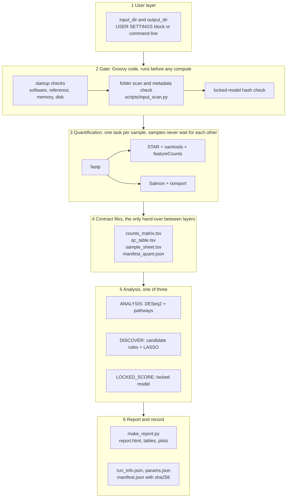

**Design in six points**
1. **One entry, thin layers.** `nextflow/main.nf` only wires stages; the work is in `modules/` (one file per tool or step) and `nextflow/bin/` (the R and Python scripts the processes call).
2. **The gate runs first.** `modules/folder_input.nf` (Groovy functions `startupChecks`, `folderInput`, `runStartInfo`) checks the install, the input folder and the lock before a single task starts, because the samplesheet has to exist when the workflow is defined. Nothing is created at a mistyped path.
3. **Contract files decouple quantification from analysis.** Quantification ends in `contract/` (counts, QC table, sample sheet, manifest). Every analysis stage reads only those files, so each stage can be run, stopped or repeated on its own (`-entry QUANT`, `-entry ANALYSIS`, `--stop_after`).
4. **Parallel where it is safe, serial where memory demands it.** Per-sample steps run as soon as their own files are ready; the cohort steps start after all samples are done. One local executor with 16 CPUs and a 58 GB memory budget: STAR runs one at a time (about 29 GB), Salmon two at a time (28 GB each), so the 64 GB pod is never over-committed.
5. **One conda environment per tool family**, never mixed: `fastp`, `star`, `salmon`, `samtools`, `subread`, `multiqc`, `pyqc` (Python), `rseqc` (strandedness check), `r_dge`, `r_classifier`, `r_pathway`. This is how Python, R and command-line tools live in one workflow.
6. **Fixed settings in files, per-run settings on the command line.** All thresholds are in `conf/thresholds.config`, the locked model is in `lock/diagnostic_v1/` (hash-checked at the start and end of every run), and the only values a user changes are `input_dir` and `output_dir`.

## 5. Quality control: which samples are kept

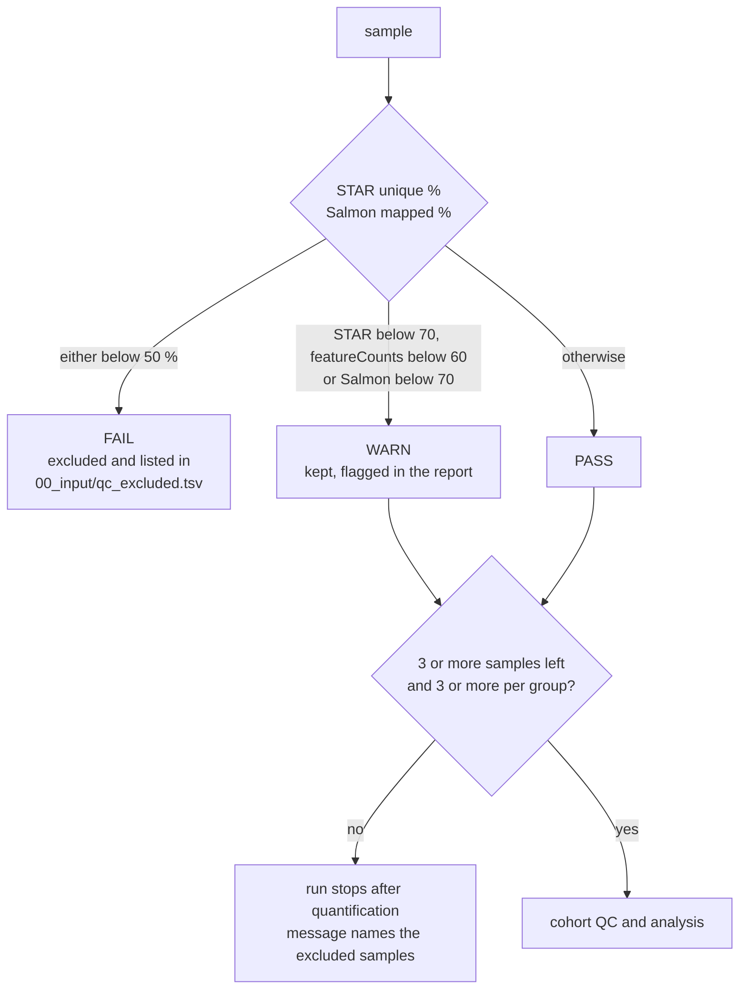
Cohort QC also flags (does not remove) samples more than 3 robust standard deviations from their study-by-group centre. `--stop_after quant` lets you inspect all of this before the analysis starts.

## 6. Modes and options

| Option | Meaning |
|---|---|
| `--mode discover` (default) | DESeq2, pathways, candidate rules, LASSO model, biomarker list, report |
| `--mode apply --cohort development\|validation` | Score the samples with the **locked** model. `--cohort` is only a label (and, for `validation`, the QC table is required for the evaluation); it never changes a score, the cutoff or a QC rule |
| `--stop_after quant\|analysis\|discover` | Stop after that stage, still write a report; continue with the same command plus `-resume` |
| `--check_only true` | Print the startup checks and stop: software, reference, memory, disk, and that the input folder has FASTQ files and a `metadata.csv`. It does not validate the pairing, file names, metadata columns or group labels (those are checked when the run starts, before any computation), and it still creates the output folder with `logs/`. |
| `-resume` | Reuse finished steps; the input scan must be identical, otherwise start a new `output_dir` |

**Rule 3b (leave-one-out robustness).** A gene must keep passing the DE rule, in the same direction, when each sample is left out in turn: at least `ceil(0.9 x N)` of `N` refits (18 of 19 for the 19 development samples). A refit that would leave a batch with only one group is **skipped and reported**; the threshold then uses the refits that ran. With fewer than 10 refits, rule 3b is reported as **NOT EVALUABLE** and no candidate is declared. With only a few samples the LASSO model is not fitted.

## 7. What you get (`Result/`)

```
Result/
  00_input/          scan of the folder, resolved metadata, sample sheets, qc_excluded.tsv
  01_fastp/  02_alignment/  03_quant_salmon/  04_counts/  contract/
  05_cohort_qc/      PCA, correlation heatmap, library sizes
  06_dge/            volcano, MA, top-50 heatmap, DE tables       (discover)
  07_pathway/        ORA and GSEA tables and plots                (discover)
  08_multiqc/        combined MultiQC report (01-04 each also have the MultiQC of their own stage in qc/)
  09_discover/       candidate_table.tsv, model files             (discover)
  09_locked_model/   scores.tsv, evaluation.tsv                   (apply)
  10_report/         report/report.html, report.md, plots/, tables/, manifest.json
  logs/  run_info.json  params.json  tool_versions.tsv  work/
```

## 8. Example output (a mechanics test, not a result)

The figures below come from 6 **development** samples (3 normal, 3 tumour), 100,000 read pairs each, run through the workflow to test it. With so few samples the DESeq2, pathway, rule and LASSO results are a **mechanics check only, not a biomarker result**.

**Sample QC**

| PCA of the samples | Sample correlation | Library sizes |
|---|---|---|
| 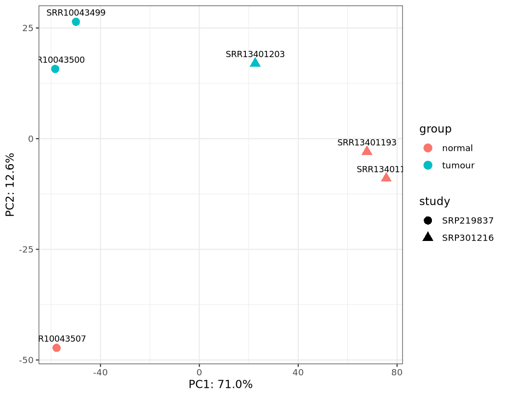 | 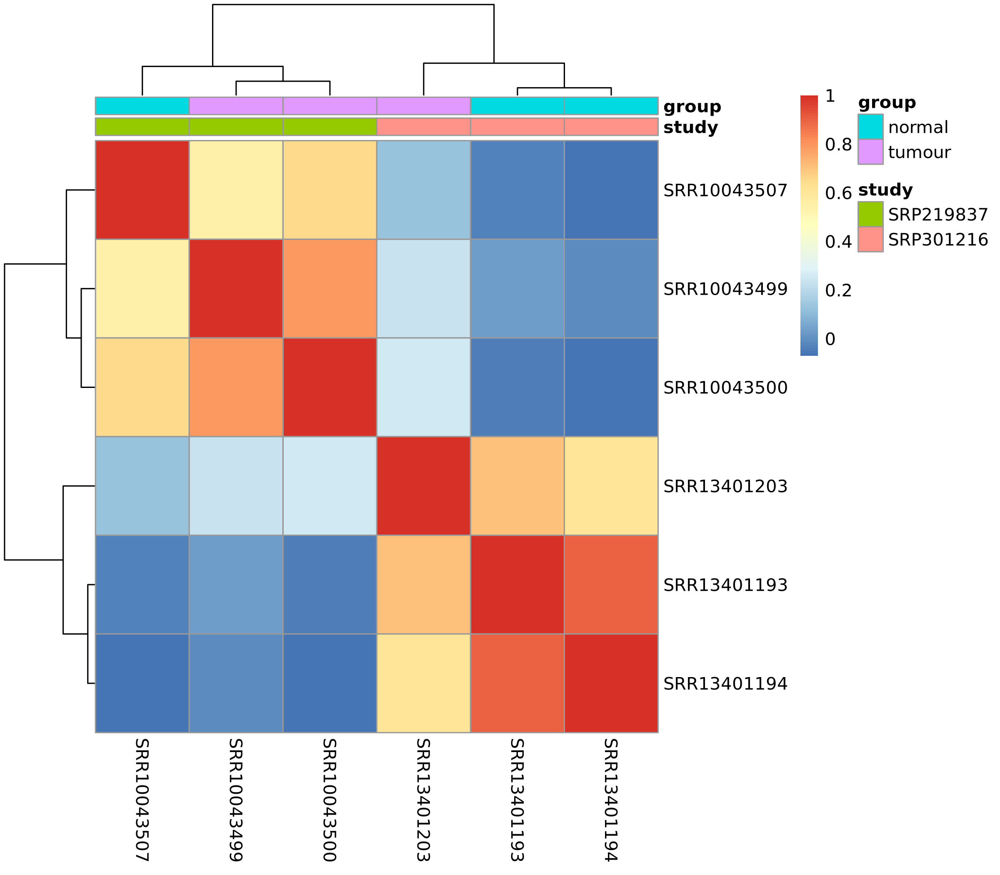 | 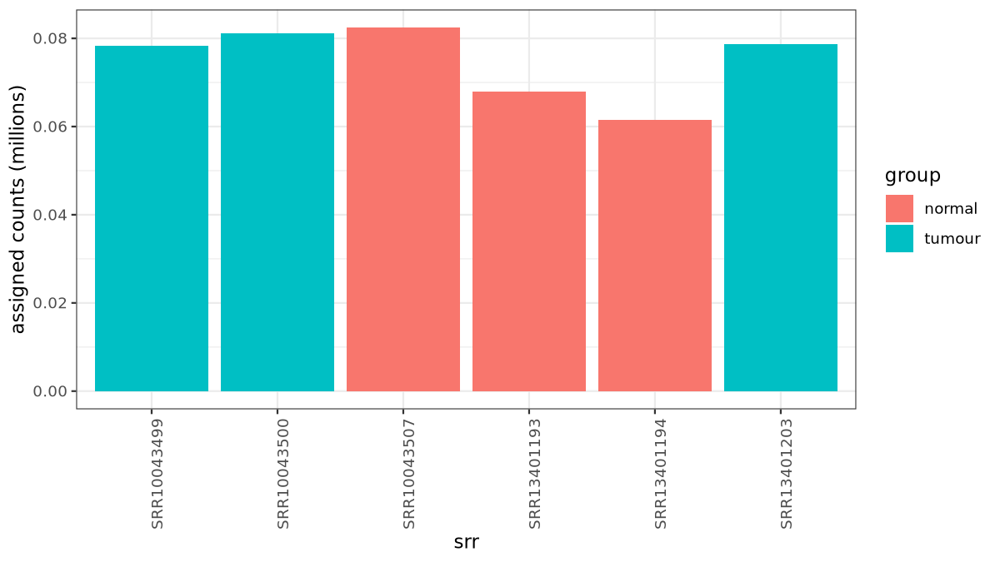 |

**Differential expression and pathways (discover mode)**

| Volcano | MA plot | Top-50 heatmap |
|---|---|---|
| 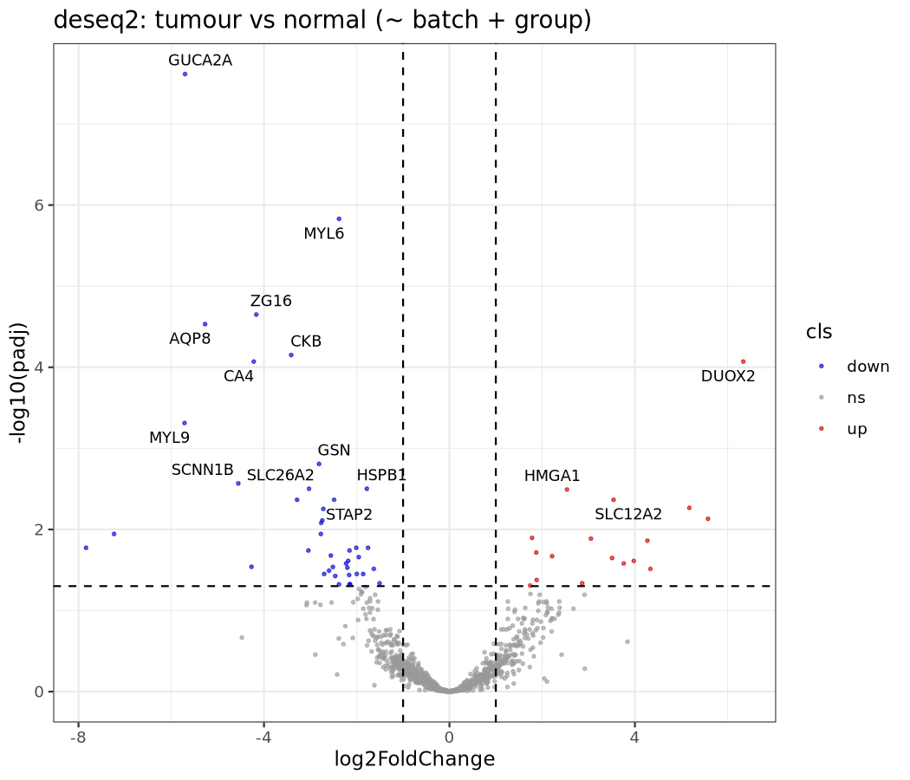 | 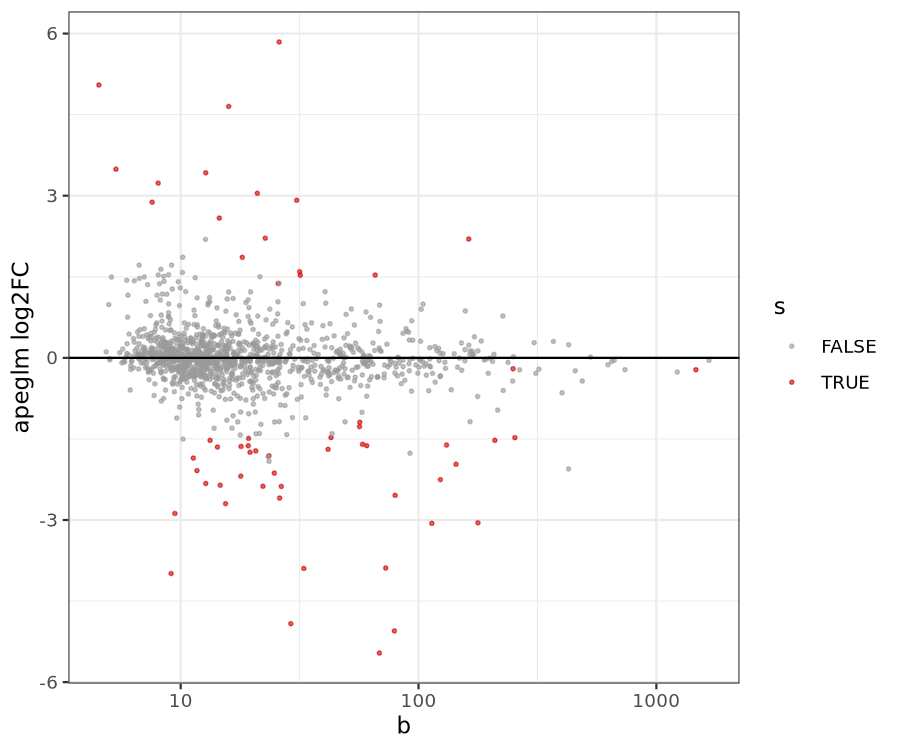 | 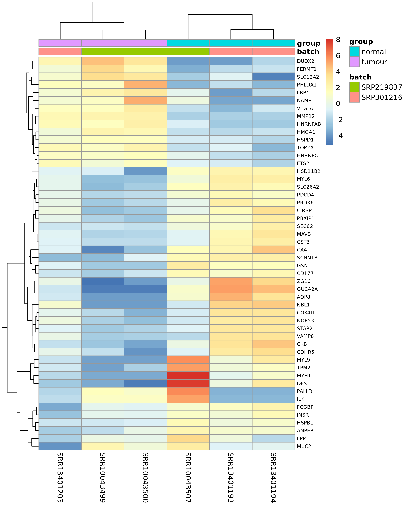 |

| Pathways, over-representation | Pathways, gene-set enrichment |
|---|---|
| 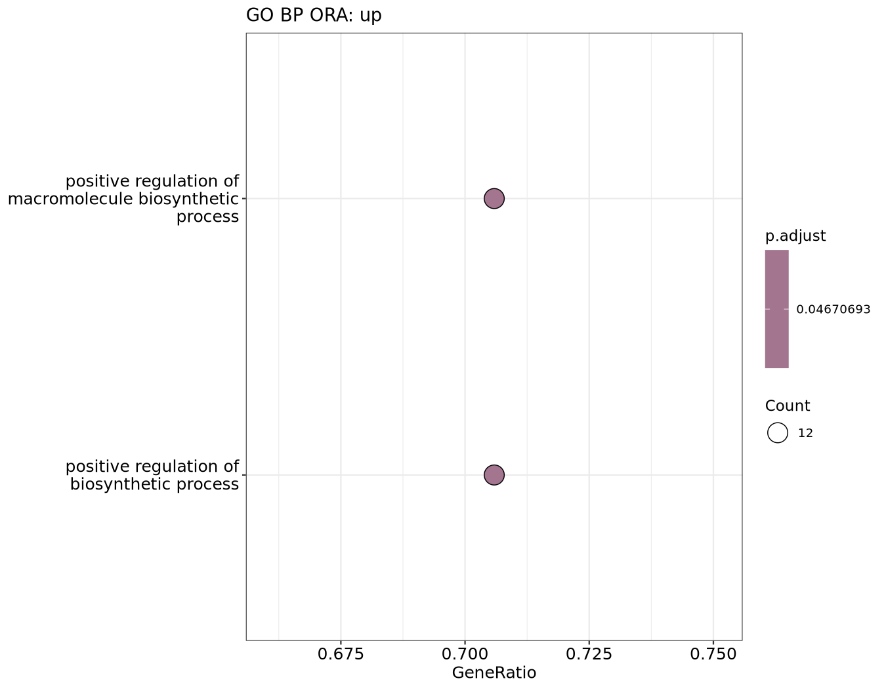 | 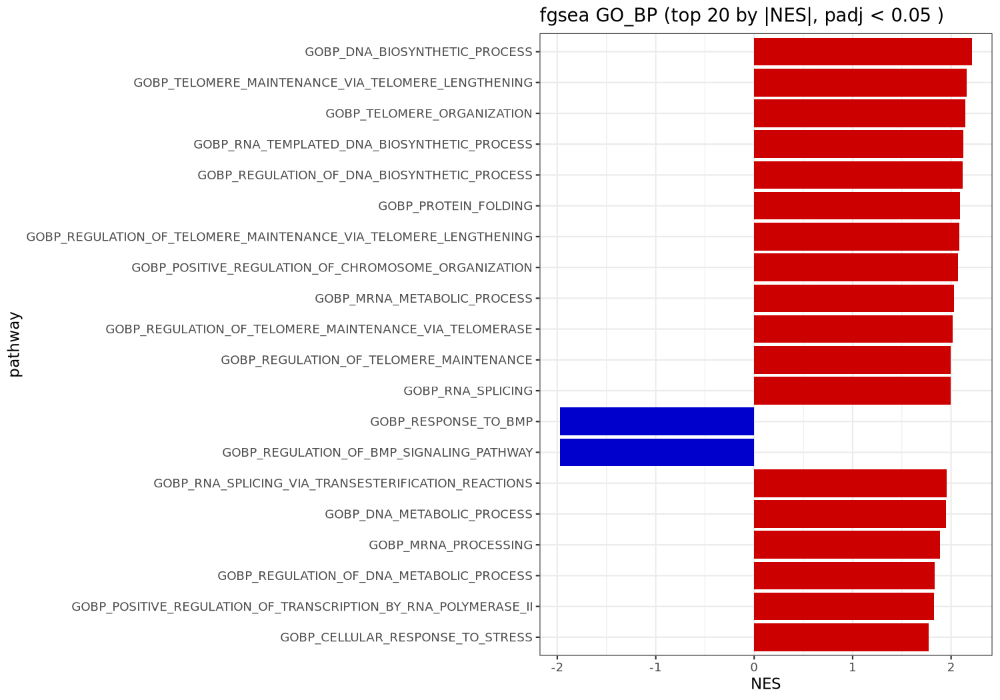 |

**Locked model, apply mode** (the 6 development samples: all 6 called correctly; these samples were used to build the model, so this is **not** the validation)

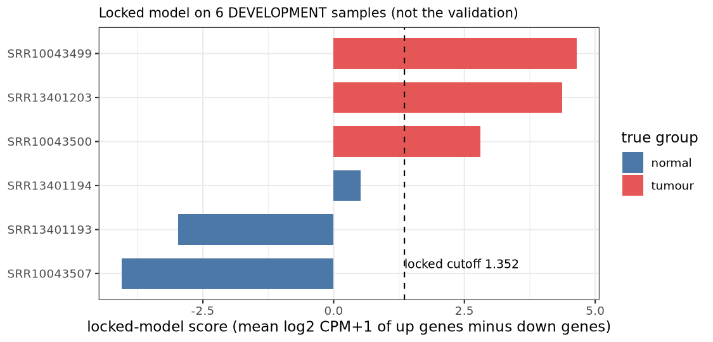

## 9. Needs and run times

| Item | Value (measured) |
|---|---|
| Pod | 16 CPUs, 64 GB memory recommended. The aligner needs a memory limit of at least 32 GiB (the run stops otherwise, never bypassed) |
| STAR and Salmon | about 29 GB and 26.6 GB peak each (one STAR job at a time) |
| 3 samples, about 2 GB FASTQ each, apply mode | 24 min 25 s, whole-pod peak 38.99 GiB |
| 6 samples, 100,000 pairs each | apply 9 min 40 s; discover about 10 min up to the candidate rules, then 1 min 8 s with `-resume` (72 tasks reused) |
| Work space | about 13 GB per full-size sample (the free-disk check on a shared volume is a warning only) |
| 19 samples (10 normal, 9 tumour, about 2 GB FASTQ pairs), discover mode, 16 CPUs / 64 GB | **2 h 49 min 54 s** (run `ecstatic_noyce`, 21 October): the per-sample steps take about 2 h 45 min (Salmon alone about 2.9 CPU-hours, median 9.4 min per sample), the cohort steps (DESeq2, pathways, candidate rules, LASSO, report) about 5 min |
| How many jobs run at once | set by the pod: STAR needs 33 GB and 8 CPUs per job, Salmon 28 GB and 8 CPUs. Salmon jobs at once = min(RAM / 28 GB, CPUs / 8); STAR jobs at once = max(1, RAM / 33 GB) and at most CPUs / 8. On the 64 GB / 16-CPU pod: **2 Salmon and 1 STAR** (measured peak concurrency in the 19-sample run). A larger pod raises this (for example 4 Salmon jobs need about 112 GB and 32 CPUs); **NOT TESTED** on a larger pod |
| RNA-QC metrics (RSeQC) per full-size sample, measured on a 2.6 GB BAM on a heavily loaded host | read distribution 231 s / 1.3 GB, duplication 174 s / 2.4 GB, TIN (5,000 transcripts) 495 s, gene-body coverage (1,000 transcripts) 146 s, strandedness 6 s: about 17.5 min and at most 2.4 GB per sample on one CPU, in parallel with the STAR jobs. Switch off with `run_rnaqc = false` |
| Several runs at once on one pod | **not supported**: each Nextflow run assumes it owns the whole pod. Run one job at a time per pod (the service in `service/` queues jobs for this reason) |

## 10. Tests and verification

| Test | Result |
|---|---|
| Stub suite (`tests/integration/one_workflow_stub.sh`): structure, resume, apply, stop-after, startup checks, input errors, report, strandedness and RNA-QC wiring | 90 of 91 at the last full run (the 91st, a byte-identity guard, now runs from a vendored fixture) |
| Regression on the 19 development samples (`tests/regression/run_regression_branch.sh`): decisions | 30 of 30 pass; diagnostic checks 48 of 48 |
| Numeric acceptance against a control run of the frozen code on the same pod (`check_numeric_tolerance.py`, tolerance 1e-5) | accepted; 45 data files byte-identical |
| Apply on the 3 development samples (07:41 code) | counts identical to the 8-9 October counts |
| Real run on the **15 validation samples** | **not run** |
| Input scanner tests (`tests/integration/test_input_scan.py`): naming styles, aliases, missing mates, duplicates, metadata errors, per-group minimum | 30 of 30 pass |
| Thin job service (`service/tests`, a stand-in replaces Nextflow, the real pipeline is not started): upload rules, validation, queue order, cancel, resume, delete, workflow-chart statuses, summary and figures, report download, localhost-only guard | 25 of 25 pass; the page itself was exercised in headless Firefox (`service/tests/browser_check.py`, 16 of 16 checks, no JavaScript errors; a live moving job was not watched) |
| Small cohort (6 samples, 3 + 3, single batch) through the real DESeq2, candidate-rule and model scripts | runs to the end; rule 3b is reported NOT EVALUABLE and no model is fitted (see section 11) |

## 11. Known limits

- Only the STAR + featureCounts route is supported by the one-workflow entry; human, paired-end, colon tissue; diagnostic question only.
- The locked model is valid only for the colon tumour-vs-normal question scored on featureCounts counts with GENCODE v50 IDs.
- `analysis_min_samples_per_group = 3`, the QC thresholds and the 10-refit minimum are **provisional**.
- A failed run does not write a report.
- The report states that a model was not fitted, and why (rule 3b not evaluable), only from the candidate-rules note; the "Gene selection was done ..." banner appears only when a model was fitted. These report text changes were checked on the demo job output (6 samples) and by the stub suite, not on a larger real run.
- Third-party licences: see `THIRD_PARTY_LICENSES.md` (an inventory with verified/not-verified marks; not legal advice). The pipeline's own code is under the MIT licence (`LICENSE`, added 2026-10-23 by owner decision; the copyright holder line can be changed). Tools it runs as separate processes keep their own licences (Salmon 1.10.3 is GPL-3.0; MultiQC, RSeQC GPL).
- Salmon quantification is **not exactly repeatable** run to run for some samples (about 2 % of reads, concentrated in near-identical paralog groups). The featureCounts route is repeatable. Genes sitting at the rule-1 cut-offs can change between runs; the audit of the 19 samples is in `validation_audit_*/` (outside git).
- The nine-gene selection depends on the order of the candidate genes (an alphabetical order selected 8 genes in the audit) and on the seeds. Development performance is in-sample.
- Any cohort size is accepted (at least 3 samples per group). Stages that need more samples are skipped with a warning: with fewer than 10 leave-one-out refits rule 3b is NOT EVALUABLE, so no candidate is declared and no model is fitted (`NO MODEL FITTED`, exit code 0; this does not mean that no biomarker exists). Above 60 samples the leave-one-out method is not allowed by `config/questions.yaml`, and the run stops at the discovery input check after quantification.
- `--check_only true` does not validate pairing, file names or metadata contents; use `scripts/input_scan.py` for that (see `docs/INTEGRATION_GUIDE.md`).
- No several-runs-at-once, queue, or multi-node execution inside the pipeline (executor `local` only); see section 17 for the service queue.
- Development results (AUC 1.0 on its 19 training samples) are optimistic and are not validation. The pre-registered pass rule for the validation is at most 1 error per class, overall and within each study.

## 12. Repository map

| Folder | Content |
|---|---|
| `nextflow/` | `main.nf`, `nextflow.config` (USER SETTINGS block at the top), `bin/` helper scripts |
| `modules/` | one Nextflow module per tool or step |
| `conf/` | all thresholds (`thresholds.config`), input rules (`input.config`) |
| `config/` | candidate rules, question settings |
| `lock/diagnostic_v1/` | the locked model and its hash list (never edited by a run) |
| `scripts/` | launchers, input scan, locked scoring, report |
| `service/` | thin job service (HTTP API, one-job-at-a-time queue, one-page UI) around the pipeline command; standard library only; see `service/README.md` |
| `tests/` | stub suite, regression checks, numeric acceptance |
| `docs/` | `RUN_IN_5_STEPS.md`, `README_one_workflow.md`, `HANDOVER_diagnostic.md`, design notes, `img/` |
| `examples/` | example input builder and the score-plot script |

Not in git (in the install folder): `ref/` (genome, annotation, indexes), `env/` (tool environments), `data/` (development FASTQ), `results*/`.

## 13. Extending the pipeline

**A new question (for example prognostic or predictive).** Not built; today a run that asks for another question stops with "only 'diagnostic' is implemented" (`main.nf`) and `config/questions.yaml` marks both as `not_implemented`. The route a new question would take (a proposal, not code that exists):
1. Write and approve a pre-registration first (`docs/PREREG_prognostic_DRAFT.md` is the only draft so far); fix every threshold before any real data is used.
2. Add its settings, marked PROVISIONAL until approved, to `config/questions.yaml` (the prognostic ones already listed there are placeholders).
3. Add the input checks for its data (survival time and event, or treatment arm and response) next to `nextflow/bin/check_discover_input.py`.
4. Add the statistical steps as new modules in `modules/`, reading only the `contract/` files.
5. Add the question to the workflow selection in `nextflow/main.nf` and its sections to `scripts/make_report.py`.
6. Add stub tests (`tests/integration/`) and a regression check; run the acceptance rule against a control (section 10).
7. Keep the diagnostic outputs byte-identical (the regression shows it) and never write into `lock/`.

**A new tool.** Add its environment under `env/`, a module in `modules/` with `label` and resource settings, include it in `main.nf`, add a `stub:` block (the stub suite must pass), and record its version in `docs/tool_versions.tsv` (`scripts/record_versions.sh`).

**A changed threshold.** Only in `conf/thresholds.config`; every change goes into the run record (`params.json`) and, for the locked model, is not allowed at all.

## 14. Reproducibility record

Every run writes, into its own output folder, what is needed to repeat or audit it:

| File | What it holds |
|---|---|
| `run_info.json` | command line, git commit and list of uncommitted files at the start, lock hash check at start and end (7 of 7), pod size, every attempt (new or resume) with status, and at the end the reference record (GENCODE release, md5 and sizes of the reference files, copied from the quantification manifest; md5 only, the whole STAR and Salmon index is not hashed) |
| `params.json` | every parameter of the launch |
| `tool_versions.tsv` | the real installed version of every tool |
| `10_report/manifest.json` | sha256 of the inputs, the config files, the lock files and every report file, plus the same reference record |
| `logs/` | Nextflow trace, timeline and report per launch (one set per attempt) |
| `09_discover/*/*.provenance.txt` | per discovery step: the exact command, tool versions, sha256 of inputs and outputs |
| `work/` | the Nextflow work folder (needed for `-resume`) |

A result is only comparable with another if `run_info.json` shows the same commit, **no uncommitted files** and the same parameters.

## 15. FAQ

| Question | Answer |
|---|---|
| The run stopped right after quantification | Fewer than 3 samples (or fewer than 3 in a group) passed QC. The message lists the excluded samples and the reason; also see `00_input/qc_excluded.tsv`. Add samples or look at why the failing ones failed; do not lower the limit casually. |
| What does NOT EVALUABLE mean? | Rule 3b needs at least 10 leave-one-out refits. If too many were skipped (or the cohort is tiny) the rule cannot be judged, so no candidate is declared. It is neither a pass nor a fail. |
| Why is there no model in my discover run? | Fewer than 2 genes passed all rules, so the LASSO did not run. The report says "NO MODEL WAS FITTED". This is not a negative biomarker finding. |
| Is the example result a biomarker result? | No. The 6-sample example is a mechanics test. The report says so in a box at the top. |
| What is the difference between `--cohort development` and `validation`? | Only the label (and the QC requirement for the evaluation). The score, cutoff and QC rule are identical. The 15 validation samples must use `validation`; development samples must never. |
| How do I continue a stopped run? | Same command plus `-resume`, from the same folder, with the same `output_dir`. If the input folder changed, use a new `output_dir`. |
| Can I run it without the full path to nextflow? | Yes: `export PATH=/workspace/Biomarker_pipeline/env/bin:$PATH`. |
| Where do I see what failed? | The console shows the failing step and its work folder; `Result/logs/` has the trace and timeline; the failing step's `.command.err` holds its own error message. |
| Why does a run need 64 GB? | The STAR index alone is 26.5 GB and STAR peaks at about 29 GB; the run refuses to start below 32 GiB. |

## 16. Glossary

| Term | Meaning here |
|---|---|
| FASTQ | the raw reads of one sample (two files: R1 and R2) |
| fastp, STAR, featureCounts, Salmon | trimming, alignment to the genome, counting reads per gene, and alignment-free counting |
| tximport | turns Salmon transcript estimates into gene counts |
| sample QC / cohort QC | per-sample mapping checks (PASS, WARN, FAIL) / cohort-level PCA and outlier flags |
| DESeq2 | the differential-expression method (tumour vs normal); `padj` is the multiple-testing adjusted p-value, `log2FC` the fold change |
| ORA, GSEA | two pathway methods: over-representation of significant genes, and rank-based gene-set enrichment |
| batch, study | the group of samples sharing a technical origin; the model corrects for it when there are several |
| candidate rules 1, 2, 3a, 3b | the gene filter: significance and size of change, enough expression, agreement of both quantification routes, robustness when each sample is left out |
| LASSO | a penalised regression that picks a small gene set and fits the score model |
| locked model | the fixed 9-gene score with its cutoff; applied, never refitted |
| cohort (development / validation) | a label: development samples built the model, validation samples are independent |
| contract files | the counts, QC table and sample sheet that hand the data from quantification to the analysis |
| stub run | `-stub-run`: a fast structure test in which every step only writes placeholder files |

## 17. Job service (thin interface)

`service/` wraps the single pipeline command for a user interface: upload paired FASTQ files and `metadata.csv`, validate them with the pipeline's own scanner (`scripts/input_scan.py`), queue the job, run `nextflow run nextflow/main.nf --input_dir <job input> --output_dir <job output> --mode discover`, show a live workflow chart from the Nextflow trace, and serve the report, a results summary and the figures. One job runs at a time; others wait. Failed or cancelled jobs can be resumed. It never modifies the pipeline, its configuration or the baseline results. It is a thin first version: **no user accounts** (it listens on localhost only; a remote address needs `SERVICE_ALLOW_REMOTE=1` and `SERVICE_API_TOKEN`; Host and Origin checks, JSON-only writes and sandboxed reports are always on), no cluster execution, discover mode only. Start it with `bash service/run_service.sh`; details, API and limits are in `service/README.md`.
