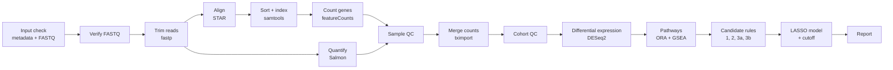
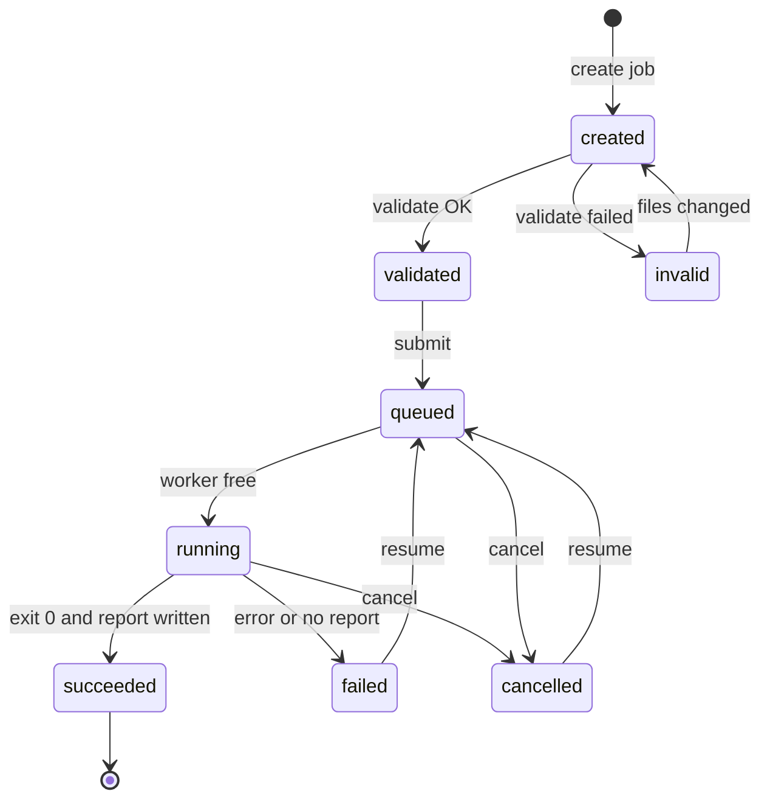

# Thin job service for the diagnostic RNA-seq pipeline

**Research use only. Results are not clinically validated.** A first, thin interface: it turns the one pipeline command into upload, validate, queue, run, results. It does **not** change the pipeline, its configuration, thresholds or any baseline result.

**There is no user login, only an optional shared token.** The service listens on `127.0.0.1` only. A non-local address needs both `SERVICE_ALLOW_REMOTE=1` and `SERVICE_API_TOKEN` (put it behind a TLS reverse proxy; list its host name in `SERVICE_ALLOWED_HOSTS`). With a token set, every request needs `Authorization: Bearer <token>` or the cookie set by opening `/?token=<token>` once. Always on: a Host allow-list (stops DNS rebinding), a same-origin check on writes (stops cross-site requests), `application/json` required for POST bodies, and served report HTML runs in a sandbox (no access to the API). Without a token, anyone who can reach the port on localhost can upload data, start and delete jobs and download results.

## Pipeline workflow (what the chart in the page shows)

The per-sample steps (verify to Salmon) run in parallel as far as memory allows (STAR 33 GB, Salmon 28 GB per job); from sample QC on, all samples are processed together.

## Job states


## Demo and About (for presentations)
- **Input Example Sample Data** (button at the top of the page): `POST /api/demo/start` copies the real demo reads from `/workspace/biomarker_demo/input` (6 development samples, 3 normal and 3 tumour from two public studies, the first 100,000 read pairs of each, about 90 MB, hashes in `SHA256_source.txt`) into a new job, validates it and queues it, so the whole pipeline runs live (about 10 minutes). It is a tool demonstration: the data are far too small for biology, and with fewer than 10 samples the biomarker model is skipped by design. The demo folder is only read; set another folder with `SERVICE_DEMO_DIR`.
- **Live workflow view** (`GET /api/jobs/<id>/live.html`, drawn by the server in `render.py` and refreshed every 2 s): an animated chart of every step with done/expected counts, a progress bar and elapsed time, a sample-by-step matrix (each sample's trim, align, sort, count, Salmon and QC state, with its group and QC status), pod memory/CPU/disk gauges, and a table that says in plain words what each step does and with which tool.
- **About this pipeline** (second tab of the page): what the pipeline is, what it is used for, use cases, what you get, how the steps fit together, limitations, and what it is not for.

## What it does
1. `POST /api/jobs` creates a job folder `<jobs>/<id>/{input,output,launch}`.
2. `PUT /api/jobs/<id>/files/<name>` uploads each file (raw body, streamed to disk). Only `metadata.csv` and `<sample>_R1.fastq.gz`-style names (letters, digits, `.`, `_`, `-`; `.fastq.gz` or `.fq.gz`) are accepted; no paths. In the page, the sample table is built from the chosen file names (same tag order as `conf/input.config`) and you pick the group of each sample; a `metadata.csv` is generated and uploaded for you, or upload your own.
3. `POST .../validate` runs the **pipeline's own scanner** (`scripts/input_scan.py`) with the arguments the one-workflow entry uses in discover mode, plus one **service check**: batch/study values may only contain letters, digits, `.`, `_`, `-`. (The scanner now rejects them too; this check is a second guard.)
4. `POST .../submit` validates again and queues the job; invalid input is never queued (HTTP 422 with the message).
5. **One worker, one job at a time.** It also waits while any other `nextflow run ... main.nf` is alive on the machine, and runs `nextflow run <code>/nextflow/main.nf --input_dir <job>/input --output_dir <job>/output --mode discover -ansi-log false` in `<job>/launch` (`-resume` added when a job is resumed). The output folder must not exist for a new job, so nothing is overwritten.
6. `GET /api/jobs/<id>` returns status, task progress, the **stage chart data** (each stage pending / running / done / failed with done/expected counts, computed from the Nextflow trace and the console log), and the log tail.
7. `GET .../summary` reads the pipeline's own output files: sample QC counts and flagged samples (`04_counts/sample_qc.tsv`), the candidate funnel and candidates that passed all rules, the model genes and cutoff or the "no model fitted" reason, and the development performance with its "optimistic, not validation" label, plus fixed limitation texts. `GET .../export.zip` returns the tables, model files, report and run record of a finished job in one zip (never `work/`). `GET .../figures` lists the report's PNG figures (`10_report/plots/`). `GET .../files/<path>` downloads from `output/` (never `work/`, hidden files or anything outside the folder). The report is `10_report/report/report.html`.
8. `POST .../cancel` removes a queued job or stops a running one. `POST .../resume` queues a failed or cancelled job again with `-resume` (finished steps are reused). `DELETE .../<id>?confirm=yes` deletes a job that is not queued or running, with its uploads and results.

A run that exits with code 0 but wrote no report is marked `failed`. After a service restart a job left `running` with no live process is marked `failed`.

## Run it
```
bash service/run_service.sh          # then open http://127.0.0.1:8080
```
Environment: `SERVICE_PORT`, `SERVICE_HOST` (default `127.0.0.1`), `SERVICE_ALLOW_REMOTE`, `SERVICE_JOBS_DIR` (default `/workspace/biomarker_jobs`), `SERVICE_MAX_FILE_GB` (default 40), `SERVICE_RETENTION_DAYS` (default 0 = keep; N = the worker deletes finished, failed, cancelled and unsubmitted jobs older than N days, never queued or running ones), `BIOMARKER_INSTALL_DIR`, `BIOMARKER_CODE_DIR`. Standard library only (the `pyqc` environment's Python 3.12); nothing to install. From a laptop use an SSH tunnel to port 8080.

## Limits of this thin version (by design)
- **No login, no user separation, no TLS** (see the top). Patient-level data needs a proper security design before real use: authentication, per-user isolation, encryption, retention and deletion rules, audit log.
- **Discover mode only.** Apply mode needs a cohort label and the colon-specific locked model; prognostic and predictive analyses do not exist.
- **One pod, one job at a time.** No cluster or cloud execution. Concurrency inside a job follows the pod: Salmon jobs at once = min(RAM / 28 GB, CPUs / 8).
- Progress is a stage chart with task counts, not a percentage. The page's JavaScript (upload table, chart, tabs) was run in a real browser (headless Firefox, `tests/browser_check.py`, 16 of 16 checks on 2026-10-23: demo table, About tab, sample builder, upload through the Origin guard, validate, Summary tab with the strandedness, RNA-QC and validation sections, live chart, export and report links, token cookie, no JavaScript errors). That check needs Firefox, geckodriver and Selenium and is not part of `unittest discover`; only Firefox was tried, and a job running live (moving progress) was not watched in a browser. The API behind the page is tested separately.
- The summary is an automatic read-out of the files. Interpretation is a separate step by the research team; nothing here says that a candidate is validated.

## Tests
```
cd service && /workspace/Biomarker_pipeline/env/prefix/pyqc/bin/python3 -m unittest discover -s tests -v
```
Real-browser check of the page (optional; needs Firefox, geckodriver, selenium in one environment; on this pod `LD_LIBRARY_PATH=<env>/lib MOZ_DISABLE_CONTENT_SANDBOX=1 FIREFOX_BIN=<env>/bin/FirefoxApp/firefox <env>/bin/python3 tests/browser_check.py <scratch folder>`; it starts its own service on ports 18200 and 18201).
25 tests against a stand-in for Nextflow (`tests/fake_nextflow.sh`); the real pipeline is never started. They cover upload rules, validation with the real scanner, the service check for unsafe batch values, the exact command, queue order, cancel (queued and running), resume (flag, log kept, finished job refused), delete (confirmation, active job refused), the stage chart statuses, the live view fragment (chart, per-sample matrix, step descriptions, resources), the demo (missing data answered clearly, one-click start, source never changed), summary and figures read from the outputs, confined downloads, the foreign-run guard, and the localhost-only guard.
